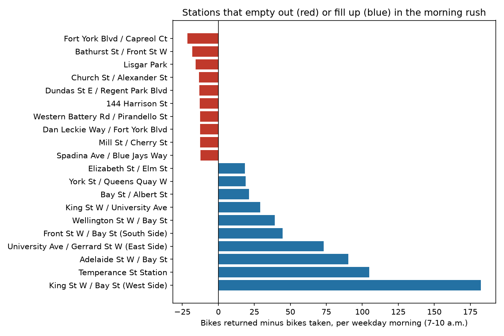
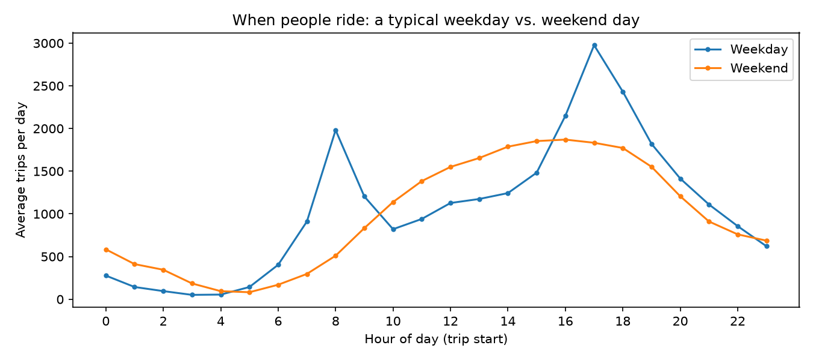
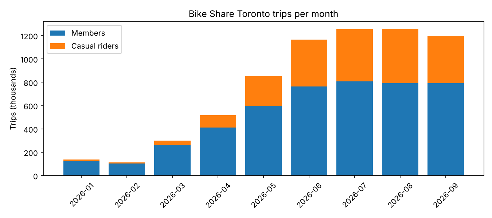
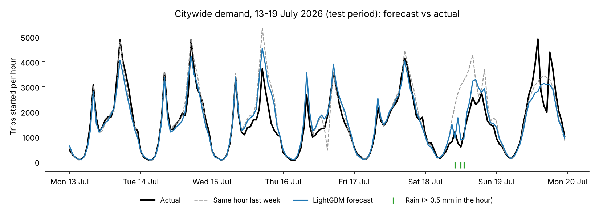

# Toronto Bike Share: from 6.8 million trips to a morning rebalancing plan

How do Torontonians use Bike Share, where does the system come under strain, and what
should the operator do about it? The project moves through three steps:

1. **What happened** (SQL): eight business questions answered with DuckDB on every trip
   from January to September 2026, plus a follow-up on one surprising result.
2. **What will happen** (Python, machine learning): forecasts of citywide demand by the
   hour and of each station's morning rush, built on 14.6 million trips since January 2025
   and hourly weather, and tested on July–September 2026.
3. **What to do** (optimisation): an integer programme that decides which stations the
   trucks should take bikes from and which they should fill before 7 a.m., tested by
   replaying every weekday morning of July–September 2026.

**Bottom line for the operator** (simulation of July–September 2026 weekday mornings):

- Moving 500 bikes before 7 a.m., with a small safety buffer, cuts the riders who meet an
  empty or full station from about 1,380 to about 830–850 per weekday morning (−39%).
- Most of the rest (about 620 a morning) is out of reach of any morning plan, even one
  that knows the future. Nearly 90% of it happens at four Financial District stations
  where 3 to 8 times more bikes arrive each morning than there are docks. A valet service
  or more docks there would help where trucks cannot.
- A more complex forecast (LightGBM) was 9% more accurate but did not produce a better
  plan than a simple four-week average. A safety buffer in the plan mattered more.

## Part 1 – What happened: key findings

1. **The morning rush moves bikes into the Financial District, and they don't come back on their own.**
   On a typical weekday morning (7–10 a.m.) in the May–September riding season, the station
   at King St W / Bay St (West Side) receives about 277 bikes but sends out only about 4.
   That leaves a surplus of roughly 270 bikes to clear every morning, more than three times
   the January–April figure (83). Six of the ten busiest morning routes end at this one
   station. Residential stations around Fort York, CityPlace and Liberty Village lose about 20–30
   bikes each at the same time. These are the first places a rebalancing crew should go.
2. **Members commute; casual riders explore.** Members make 69% of trips. Their weekday
   riding peaks at 8 a.m. and 5 p.m. Casual riders take longer trips: about 15.5 minutes
   for a typical ride, against 10.6 for members. They are more than four times as likely
   to ride for over 30 minutes (23% vs 5%), and more of their riding happens at weekends and
   on public holidays (39% vs 26%).
3. **Demand is highly seasonal.** August had 11 times as many trips as February
   (1.26 million vs 0.11 million). The casual share of riders rose from 8% in winter to 37%
   in August. Winter riders are almost all members.
4. **A small group of stations carries most of the system.** The busiest 10% of the
   1,098 stations account for 39% of all departures. The quietest half account for only 7%.
5. **The single busiest station is a leisure spot, not a commuter hub.** Centre Island
   Ferry Dock tops the list, and 96% of its riders are casual. All ten of the most popular
   routes overall are on the Toronto Islands.
6. **One "commute" route is mostly non-members riding to the train.** The second-busiest
   weekday-morning route, Grand Avenue Park → Windsor St / Newcastle St, behaves like a
   commute: 789 weekday-morning trips that way against only 8 in the other direction, and
   the reverse in the evening (633 trips back between 4 and 7 p.m.). The ride takes about
   5 minutes and ends near Mimico GO Station, so these are most likely riders cycling to and
   from the GO train. Demand is steady: there were morning trips on this route on 157
   weekdays. Yet 55–66% of the trips are made by casual riders, not members, which makes
   this station pair a natural place to promote membership.

| | Members | Casual riders |
|---|---|---|
| Share of trips | 68.5% | 31.5% |
| Typical (median) trip | 10.6 min | 15.5 min |
| Longest 10% of trips start at | 24 min | 55 min |
| Trips over 30 minutes | 5.0% | 23.0% |
| Trips on weekends or public holidays | 25.7% | 38.5% |
| Trips on e-bikes | 19.5% | 24.8% |

## Part 2 – What will happen: forecasting demand

All forecasts are made one day ahead, as an operator planning tomorrow would. They are
tested on July–September 2026, which the models never see while being fitted (training
data: January 2025 – June 2026). Each model is compared with a simple rule of thumb, so a
more complex method has to earn its place.

**Citywide trips per hour.** Inputs: hour of day, day of week, public holidays, season,
temperature, rain and humidity, and recent demand (the same hour yesterday and last week).

| Forecast | Typical error per hour | Error as % of trips (hourly) | Error as % of trips (daily total) |
|---|---|---|---|
| Same hour last week (rule of thumb) | 355 trips | 21.1% | 16.3% |
| Regression | 294 trips | 17.5% | 9.9% |
| LightGBM (gradient-boosted trees) | 238 trips | **14.1%** | 9.9% |

LightGBM cuts the hourly error by a third compared with the rule of thumb. For whole-day
totals, the simpler regression does just as well. The regression also measures what
weather does to demand, holding time of day, season and recent demand fixed:

- Rain falling in that hour: **39% fewer trips**.
- 1 mm of rain in the previous three hours: 19% fewer trips, even once it has stopped.
- A 20 °C hour instead of a 10 °C one: 25% more trips.

**Each station's morning rush.** For every station and working weekday, the models forecast
bikes taken out and bikes returned between 7 and 10 a.m.; the difference (the net flow) is
what a rebalancing plan needs.

| Forecast | Typical error in a station's net flow |
|---|---|
| Same weekday last week | 2.62 bikes |
| Average of the last 4 weeks (rule of thumb) | 2.25 bikes |
| LightGBM (station, weekday, season, morning weather, recent mornings) | **2.04 bikes** |

LightGBM is about 9% more accurate than the four-week average. Station mornings are
noisy, though: a typical station sees only a handful of bikes out and in, so even the best
forecast is often off by two bikes.

## Part 3 – What to do: planning the morning rebalancing

**The decision.** Before 7 a.m., trucks can move a limited number of bikes. Which stations
should give up bikes, and which should be filled, so that as few riders as possible find
an empty station (no bike to take) or a full one (no dock to return to) by 10 a.m.?

**The model.** For each station, the planner knows its number of docks and the forecast
net flow for 7–10 a.m.
- Step 1, an integer programme (PuLP with the HiGHS solver), chooses how many bikes each
  station should hold at 7 a.m. It minimises the expected number of riders meeting an
  empty or full station. A smaller penalty applies when a station is forecast to end
  within 3 bikes of empty or full, as a safety buffer against forecast error. Bikes are
  only moved, never created, and the total moved is capped by truck capacity.
- Step 2, a transport problem, pairs the stations giving bikes with the stations receiving
  them so that the trucks drive the shortest total distance.

**The test.** Every working weekday from July to September 2026 (63 mornings, 1,064
stations with a known dock count, covering 98% of morning trips) is replayed with what
riders actually did. Each station starts half full, since the data does not record real
stock levels. Plans are compared with doing nothing and with a plan that knows the future.

| Plan, with 500 bikes moved before 7 a.m. | Riders meeting an empty or full station, per morning |
|---|---|
| No rebalancing | 1,376 |
| Plan from the 4-week average | 827 (−40%) |
| Plan from the LightGBM forecast | 849 (−38%) |
| Plan with perfect foresight (best possible) | 635 (−54%) |

What the simulation shows:

1. **Planning pays off, up to about 500 bikes a morning.** Moving 500 bikes cuts the
   problems by almost 40%. Doubling to 1,000 adds little (804 with the four-week average,
   795 with LightGBM).
2. **Almost half the problem is out of reach of any morning plan.** About 620 riders a
   morning meet a full or empty station even with perfect foresight. They are at stations
   whose morning inflow is several times their dock count. Four Financial District
   stations account for 89% of them:

   | Station | Docks | Average net inflow, 7–10 a.m. (Jul–Sep 2026) |
   |---|---|---|
   | King St W / Bay St (West Side) | 39 | +295 |
   | Adelaide St W / Bay St | 23 | +167 |
   | Temperance St Station | 55 | +153 |
   | Front St W / Bay St (South Side) | 19 | +72 |

   Emptying these stations overnight cannot absorb inflows of this size. Staff collecting
   bikes there during the rush (a valet service), more docks, or trucks emptying them
   mid-morning can.
3. **A better forecast did not make a better plan; the safety buffer did.** LightGBM's
   station forecasts are 9% more accurate, but its plan does no better than one built from
   a simple four-week average (849 vs 827). Leaving out the safety buffer made both plans
   worse (959 for LightGBM, 986 for the four-week average), so how a plan handles uncertainty matters more than squeezing a
   little more accuracy out of the forecast. Making the buffer bigger (6 bikes instead of
   3) did not help either (855 and 871).

**An example plan.** On Wednesday 15 July 2026, the plan moves 500 bikes in 165 station-to-station
moves, about 1.9 km per bike on average. The largest moves take bikes from Financial
District stations that fill up during the rush to residential stations that empty out:
Temperance St Station → Oak St / Sumach St (10 bikes), Bremner Blvd / Rees St → Dan Leckie
Way / Fort York Blvd (9), Union Station (North) → Fort York Blvd / Capreol Ct (9). The full
list is in [`model/results/example_day_moves.csv`](model/results/example_day_moves.csv).

### The code for Parts 2 and 3

| File | What it does |
|---|---|
| `model/get_data.py` | Downloads trips for 2025–2026, hourly weather and the station list |
| `model/panels.sql` | SQL that builds the modelling tables: trips per hour (zero-filled), and bikes out and in per station on every working weekday morning |
| `model/build_panels.py` | Runs `panels.sql`, aligns the weather to local time, saves `model/data/` |
| `model/forecast.py` | Baselines, regression and LightGBM; tested on July–September 2026 |
| `model/rebalance.py` | Integer programme, transport problem and the replay of the test mornings |

## Part 1 in detail: the questions and the SQL behind them

| File | Question | SQL techniques |
|---|---|---|
| `01_clean.sql` | Load and clean the raw trip file | Reading CSV straight from disk, explicit type conversion (`TRY_CAST`, `TRY_STRPTIME`), regex column matching, `CASE` recoding, a public-holiday lookup table (`VALUES` + `LEFT JOIN`), a data-quality report built with `UNION ALL` and `FILTER` |
| `02_monthly.sql` | How does ridership change through the year? | `GROUP BY` month, conditional counts (`FILTER`), `MEDIAN`, month-over-month change with `LAG` |
| `03_hourly.sql` | When during the day do people ride? | Common table expressions (CTEs), averaging per day, share of the day with `SUM() OVER (PARTITION BY …)` |
| `04_top_stations.sql` | Which stations are busiest? | `RANK`, running totals with window frames, joining to a station lookup table |
| `05_concentration.sql` | How unequal is demand across stations? | `NTILE(10)` to split stations into ten equal groups |
| `06_imbalance.sql` | Which stations empty out or fill up in the morning? | `UNION ALL` to stack departures and arrivals, normalising per day by season, a self-join to set peak and off-peak side by side, two-way ranking |
| `07_routes.sql` | What are the most popular routes, overall and for commuters? | Two joins to the same table (start and end station), `ROW_NUMBER` within groups |
| `08_riders.sql` | How do members and casual riders differ? | Percentiles (`QUANTILE_CONT`), shares built from `CASE` inside `AVG` |
| `09_spotlight_route.sql` | Follow-up: why is one short route a top commute? | Filtering joins to pick out two stations, string concatenation for direction labels, time-of-day buckets with `CASE`, `COUNT(DISTINCT …)` |

`run_all.py` runs the nine files in order. It saves each answer to `results/` and draws
the three charts. The full output of every query is in
[`results/summary.md`](results/summary.md).

## Data cleaning

| Step | Trips |
|---|---|
| Records in the file | 6,830,174 |
| Missing a start or end station | 12,951 |
| Shorter than 1 minute or longer than 3 hours | 26,934 |
| **Kept for analysis** | **6,790,289 (99.4%)** |

Very short trips are usually a rider re-docking the same bike. Very long ones are usually
bikes that were not returned properly. Each station gets the name it appears under most
often, and extra spaces in names are removed. Ontario public holidays are grouped with
weekends, because commuting largely stops on those days. Rider labels are mapped to "Member" or
"Casual" in a way that also works for older files, which used "Annual Member" and
"Casual Member". The few trips on an unlisted bike model (ASTRO, 1%) are kept, but they
are not counted as e-bikes.

## Limitations

- October–December 2026 data has not been published yet, so totals for the year so far
  lean towards the summer. Monthly and seasonal figures are reported separately for this reason.
- Public holidays (seven in January–September) are grouped with weekends. Other days off,
  such as school breaks, are still counted as ordinary weekdays.
- The data has no rider IDs, so it cannot show whether the same people ride a route every
  day or many people ride it once. For the Mimico route, the evidence of a regular commute
  is the steady daily pattern, not repeat riders.
- Trip records show only where a ride starts and ends. They don't show bikes moved by
  the operator's trucks, so the morning surplus measures *rider* flows, not how full each
  station actually was.
- Riders who find no bike and walk away leave no record, so the forecasts predict trips
  taken, not trips wanted.
- The forecasts use the weather that actually occurred, standing in for a next-day
  weather forecast; real forecasts would be less accurate.
- The rebalancing test assumes every station starts the morning half full and looks at
  each station's net flow over the whole morning. Within-morning timing can make things
  worse, so the counts are a lower bound, and they compare plans with each other rather
  than with what actually happened. Dock counts are an October 2026 snapshot.

## How to run it

1. `pip install -r requirements.txt`
2. `python model/get_data.py` downloads the raw data (about 2 GB, not included in this
   repository) into `data/`.
3. Part 1: `python run_all.py` (1–2 minutes).
4. Parts 2 and 3: `python model/build_panels.py`, then `python model/forecast.py` (about
   1 minute) and `python model/rebalance.py` (about 15 minutes). The tables these steps use
   are saved in `model/data/`, so `forecast.py` and `rebalance.py` also run without the raw data.

## Data sources

- Bike Share Toronto Ridership Data, City of Toronto Open Data Portal. Contains information
  licensed under the
  [Open Government Licence – Toronto](https://open.toronto.ca/open-data-license/).
- Hourly weather, Toronto City station, Environment and Climate Change Canada, under the
  [Open Government Licence – Canada](https://open.canada.ca/en/open-government-licence-canada).
- Station locations and dock counts: Bike Share Toronto's public GBFS feed
  (`station_information`), downloaded 19 October 2026.
