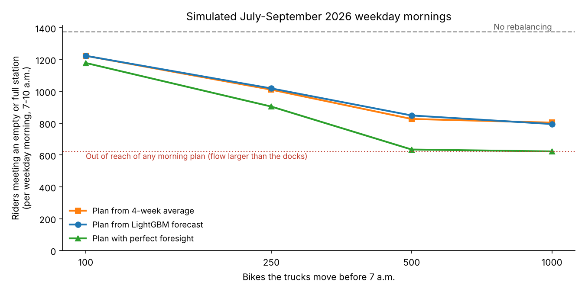

**The question.** Every weekday morning, commuters ride Bike Share from residential areas
into downtown. Some stations run out of bikes and others run out of free docks, so riders
cannot rent or return a bike. Before 7 a.m., the operator's trucks can move a limited number
of bikes. Where should they take bikes from and where should they bring them, and how much
does good planning help?

**What I did.** I used every trip from January 2025 to September 2026 (14.6 million) in three
steps. *What happened* (SQL): I cleaned the 2026 records (99.4% kept) and found where and
when the system comes under strain. *What will happen* (Python): I forecast citywide demand
by the hour and each station's morning rush using hourly weather, and tested the forecasts on
July–September 2026, which the models never saw while being built. *What to do*
(optimisation): an integer programme chooses how many bikes each station should hold at
7 a.m., with a small safety buffer against forecast error. I replayed all 63 working-weekday
mornings of July–September 2026 with what riders actually did.

{width=68%}

**What I found.**

- **Bikes flow into the Financial District and do not come back by themselves.** On a summer
  weekday morning, one station at King St W and Bay St receives about 277 bikes but sends out
  only 4. Residential stations around Fort York and CityPlace lose 20–30 bikes each.
- **Weather moves demand.** The best forecast (LightGBM) cut the hourly error from 21% to 14%
  of trips compared with a simple rule of thumb. Rain in an hour cuts trips by about 39%.
- **Planning pays off.** Moving 500 bikes before 7 a.m. cut the riders meeting an empty or
  full station from about 1,380 to about 830–850 per morning (down 39%), or about 70% of the
  problems a morning plan can reach.
- **A better forecast did not make a better plan.** The LightGBM forecast was 9% more accurate
  at station level, but its plan did no better than one built from a four-week average. The
  safety buffer mattered more.

**How sure can we be?** The data does not record how many bikes were at each station, so
every station is assumed to start half full, and only each station's net flow over the
morning is used. The results compare plans with each other; they are not a count of what
actually happened. Riders who found no bike left no record, so true demand is understated.

**What this means for decision-makers.** For the *operator*: a simple forecast plus a safety
buffer captures most of the benefit of planning; in the simulation, more truck capacity (up
to about 500 bikes a morning) helped far more than a more complex model. About 620 problems a
morning sit at four downtown stations whose inflow is several times their dock count. They
can only cope because bikes are already cleared during the rush, so mid-morning operations
there matter more than any plan made before 7 a.m. For *marketing*: one busy morning route to Mimico GO Station is used
mostly by non-members, a natural target for membership offers.

*Full analysis, SQL and Python code: https://github.com/betterandy24/toronto-bike-share-sql*
